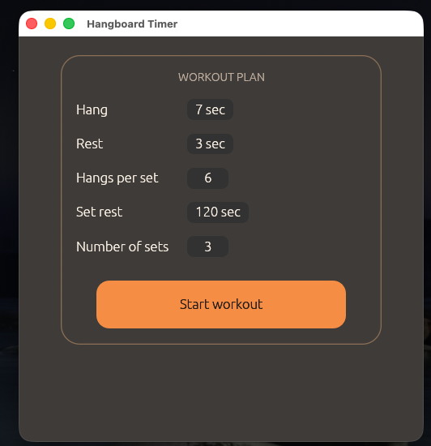
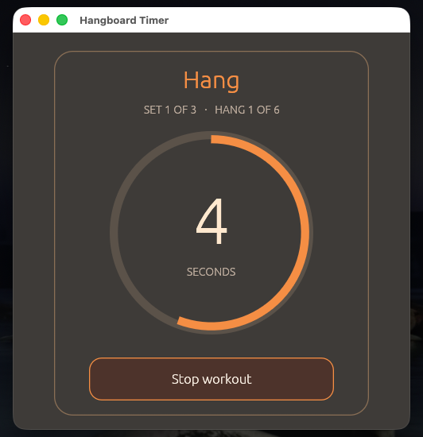

Sounds downloaded from
https://mixkit.co/free-sound-effects/notification/

## Screenshots

| Workout menu | Hang timer |
|:---:|:---:|
|  |  |

## Usage

Run the app to open the graphical hangboard timer:

```sh
cargo run
```

Set the hang and rest durations, repeats, and number of sets, then select
**Start workout**. The timer plays the existing audio cues throughout the
workout. Use **Stop workout** to end a session early.

The original terminal-based workflow is also available:

```sh
cargo run -- --cli
```

## Releases

Push a version tag (for example, `v0.1.0`) on a commit in `master` to build
macOS and Windows distributions and publish them as assets on a GitHub release.
The sound files are embedded in the executable, so the Windows ZIP contains
only the `.exe` and does not need a separate `assets` folder.
